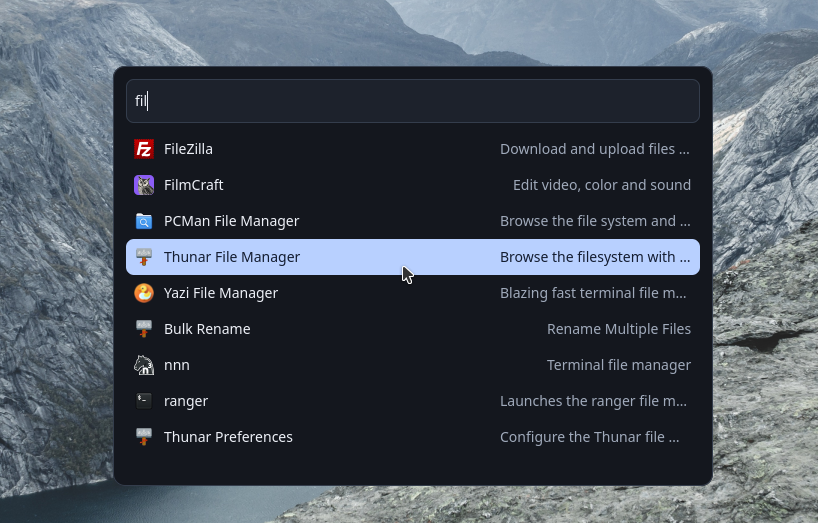

<p align="center">
  
</p>

<p align="center">
  <a href="https://aur.archlinux.org/packages/poptato-bin"></a>
  <a href="https://github.com/skorotkiewicz/poptato/actions/workflows/ci.yml"></a>
  <a href="https://www.rust-lang.org/"></a>
  <a href="LICENSE"></a>
</p>
<p align="center">
  
  
</p>

<p align="center">
  <br>
  <em>Default theme — tweakable via <code>config.toml</code></em>
</p>

**Poptato** is a small, keyboard-driven application launcher for Linux, written in Rust with GTK4. Launch desktop apps, run commands, pick from piped input, or invent your own menu modes.

No elaborate ceremony. Type, choose, **pop!** 🥔

## Get it while it's hot

**Arch Linux (AUR):**

```bash
yay -S poptato-bin
```

Then try:

```bash
poptato --mode apps
```

**Build from source:** Requires Rust 1.92+, GTK4 development files, `pkg-config`, and optionally GTK4 Layer Shell development files (enabled by default).

On Arch:

```bash
sudo pacman -S --needed base-devel rust pkgconf gtk4 gtk4-layer-shell
git clone https://github.com/skorotkiewicz/poptato.git
cd poptato
cargo install --path . --locked
```

For a GTK4-only build without layer-shell integration:

```bash
cargo install --path . --locked --no-default-features
```

## Three ways to pop (and one you make yourself)

| Mode | What it does | Try it |
| --- | --- | --- |
| **Apps** | Find and launch installed desktop applications, with icons and descriptions. | `poptato --mode apps` |
| **Run** | Find executables on your `PATH` or type a command with arguments. | `poptato --mode run` |
| **Dmenu** | Read lines from stdin, show a picker, print the selected line to stdout. | `poptato --dmenu` (with piped input) |
| **Custom** | Populate a menu from a command and optionally run an action on selection. | `poptato --mode colors` (after configuring it below) |

The search defaults to **fuzzy matching**; substring and prefix matching are also available. A query can match application names, descriptions, and keywords.

### Actually useful little tricks

```bash
# A one-off picker. The winner goes to stdout.
printf '%s\n' alpha beta gamma | poptato --dmenu -p 'Choose wisely'

# Search and print matches without opening a window.
printf '%s\n' alpha beta gamma | poptato --list --query bt

# Rofi-flavored aliases, if your muscle memory refuses to move out.
poptato -show drun

# All the switches.
poptato --help
```

Without an explicit mode, Poptato opens the configured mode (apps by default), or switches to dmenu when stdin is piped or redirected.

## Make the keyboard do the work

| Key | Action |
| --- | --- |
| `↑` / `Ctrl+K` | Previous match |
| `↓` / `Ctrl+J` | Next match |
| `Page Up` / `Page Down` | Jump one page |
| `Enter` | Accept the selected match |
| `Shift+Enter` | Accept what you typed (in modes that permit it) |
| `Esc` / `Ctrl+G` | Cancel |

Typed text is also accepted with `Enter` when there are no matches and the mode allows custom input. Add `--no-custom` to require a matching item.

### Give it a hotkey

Bind `poptato --mode apps` in your compositor or desktop environment, and your launcher is one keypress away. For example, in **niri**'s `binds` block:

```kdl
Mod+Space { spawn "poptato" "--mode" "apps"; }
```

On Wayland compositors with layer-shell support, Poptato opens as a keyboard-focused overlay. On X11 and other Wayland compositors, it uses an undecorated GTK window. See [GTK4 Layer Shell's compositor support](https://github.com/wmww/gtk4-layer-shell#supported-desktops).

## Season to taste

Configuration lives at `~/.config/poptato/config.toml` (or `$XDG_CONFIG_HOME/poptato/config.toml` when set to an absolute path).

Create a starting config:

```bash
mkdir -p ~/.config/poptato
poptato --print-config > ~/.config/poptato/config.toml
```

Or use just the settings you want to override:

```toml
[menu]
width = 560
lines = 8
placement = "center"

[search]
matching = "fuzzy" # fuzzy, substring, or prefix

[theme]
font_size = 16
selected_background = "#F6C46B"
selected_foreground = "#19232D"

[keys]
down = ["Down", "Ctrl+j"]
up = ["Up", "Ctrl+k"]
```

The complete, commented reference is in [config.toml](config.toml). Use `--config FILE` for another config and `--check-config` to validate it.

```bash
poptato --config ~/.config/poptato/config.toml --check-config
```

Browse the bundled themes and their screenshots in [themes/](themes/). To try Blackcurrant from the repository root, run `poptato --config themes/blackcurrant/config.toml`.

The AUR package installs themes in `/usr/share/poptato/themes/`. Try Paper with `poptato --config /usr/share/poptato/themes/paper/config.toml`.

To make Paper your default, run these commands from the repository root. This replaces any existing `config.toml` and `theme.css` in your Poptato config directory.

```bash
config_dir="${XDG_CONFIG_HOME:-$HOME/.config}/poptato"
mkdir -p "$config_dir"
cp themes/paper/config.toml themes/paper/theme.css "$config_dir/"
```

If you installed `poptato-bin` from the AUR, replace `themes/paper` with `/usr/share/poptato/themes/paper` in the copy command. To install a different theme, use its directory.

For extra styling, set `css = "theme.css"` under `[theme]`. Relative CSS paths resolve beside the config file. Style hooks include `.poptato .menu-panel`, `.menu-input`, `.menu-list`, `.menu-row:selected`, `.menu-label`, `.menu-description`, `.menu-icon`, and `.menu-empty`.

Bindings use GDK names (`Return`, `Page_Down`, `F2`) plus `Ctrl`, `Alt`, `Shift`, or `Super`. Set a binding to `[]` to disable it.

## Grow your own mode

Custom modes source their items from a command. They can print a selection or pass it to another command without mangling spaces and quotes.

Add this to `config.toml`:

```toml
[modes.colors]
prompt = "Pick a color"
source = ["printf", "%s\n", "red", "green", "blue"]
action = ["notify-send", "Color", "{selection}"]
```

Run your menu:

```bash
poptato --mode colors
```

Each exact `{selection}` argument is replaced with the chosen line as **one argument**, even if it contains spaces. Leave out `action` to print the selection to stdout. Preview the generated list with `poptato --mode colors --list`.

## Open a terminal tab

To include an embedded terminal, install the GTK4 VTE development files (`vte4` on Arch or `libvte-2.91-gtk4-dev` on Debian) and build from source.

```bash
cargo install --path . --locked --features terminal
```

Enable the tab in your config and run `poptato --mode tabs`.

```toml
[terminal]
enabled = true
```

The shell starts the first time you open Terminal and keeps running when you switch tabs or move focus elsewhere. Inside Terminal, Tab and the usual shell shortcuts go to the shell. Use Ctrl+Tab or Ctrl+Shift+Tab to switch tabs and Ctrl+Shift+W to close Poptato and end the session. If the shell exits, switch away and back to start another.

## Tiny details, big difference

- Poptato runs commands directly. For shell operators (`|`, `&&`, redirects), explicitly invoke your shell.
- Dmenu mode reads UTF-8 lines and preserves the selected text.
- Exit status is **0** for success, **1** for cancellation, **2** for errors.
- The repository includes a [`justfile`](justfile) with `just build`, `just check`, and `just test` for development.

---

Made with Rust, GTK4, and an unreasonable amount of potato confidence. Licensed under [MIT](LICENSE).
